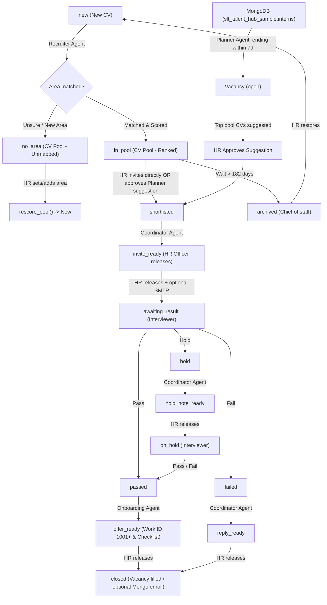

# Architecture Overview

## 1. System Design Principles

**HR Hiring** separates deterministic business rules from generative LLM tasks across **five AI agents** and **two human roles**:

- **Deterministic Code ([hiring/tools.py](hiring/tools.py), [hiring/checks.py](hiring/checks.py), [hiring/vacancies.py](hiring/vacancies.py), [hiring/db.py](hiring/db.py)):** CV text extraction (PDF/DOCX/TXT with ligature normalization), pre-tokenized weighted CV scoring (`40/30/20/10`), CV Pool ranking, interview slot allocation, work ID issuance (`1001+`), MongoDB intern matching, and strict factual grounding checks are executed entirely in plain Python.
- **Checked LLM Steps ([hiring/employees.py](hiring/employees.py), [hiring/flows.py](hiring/flows.py)):** Connects via pooled `httpx` to either local `llama-server` (`Gemma 3 4B`) or any OpenAI-compatible remote endpoint (`HR_MODEL_URL` + optional `HR_MODEL_API_KEY`). Every model output must pass code checks (up to `MAX_FIXES` retries) before falling back safely to rules/templates. Optional `HR_ALLOW_RULES_ONLY=1` lets lightweight hosted environments run continuously via rule/template fallbacks if an external LLM is unavailable.
- **Human-in-the-Loop Gatekeeping ([hiring/actions.py](hiring/actions.py), [hiring/server.py](hiring/server.py)):** HR Officer invites CVs from the CV Pool, approves Planner vacancy suggestions, manages areas, configures SMTP, and releases every email; Interviewer records `Pass`, `Fail`, or `Hold`.

---

## 2. State Machine & Agent Hand-offs

---

## 3. Dual-Database Architecture & Concurrency

- **SQLite (`data/register.db` via [hiring/db.py](hiring/db.py)):** Stores `candidates`, `drafts`, `events`, `runs`, `areas`, `vacancies`, `briefs`, `settings`, and `feedback` (`SupervisorFeedback`). Configured with **`PRAGMA journal_mode=WAL`**, `synchronous=NORMAL`, `foreign_keys=ON`, `busy_timeout=5000`, indexed foreign/query keys, and optimistic status locking (`expect_status`). Legacy SQLite schemas auto-migrate on startup via `_add_missing_columns()`.
- **MongoDB (`slt_talent_hub_sample.interns` via [hiring/talent_hub.py](hiring/talent_hub.py)):** Single source of truth for intern cohorts (no duplicate SQLite intern table). Supports three modes via `TALENT_HUB_MODE`:
  - `api`: Read-only Bearer HTTP API (`GET /api/interns`, `/api/interns/{id}`) backed by [hiring/talent_hub_mock.py](hiring/talent_hub_mock.py) or production TalentHub, with pooled HTTP connections and 15-second cache invalidation.
  - `mongo`: Direct PyMongo queries & `$facet` aggregation (`mongo_analytics`) against local `mongod` or MongoDB Atlas (`mongodb+srv://...`) using indexes on `Trainee_ID`, `field_of_spec_name`, `Training_EndDate`, `Trainee_Email`, `Trainee_Name`, and `Institute`.
  - `auto`: Uses REST API if `TALENT_HUB_API_URL` is configured, or direct MongoDB when `TALENT_HUB_API_URL` is empty.
- **Locking & Coalescing:** `WORK_LOCK` serializes LLM steps (`Recruiter`, `Coordinator`, `Onboarding`, `Chief of staff`); `PLANNER_LOCK` serializes MongoDB vacancy planning (`Planner`, suggestion refreshes); `flows.kick_background()` coalesces UI-triggered wakes so pool suggestions run cleanly after `Recruiter` completes without thread stampedes.

---

## 4. Email Pipeline, Hosting Security & Supervisor Telemetry

- **Candidate Mailer ([hiring/mailer.py](hiring/mailer.py)):** Outbound releases always save `.txt` copies in `data/outbox/`. When SMTP is enabled, dispatches multipart HTML/plain-text mail (`smtplib`), tracking `delivery_status`, `sent_to`, `sent_at`, `message_id`, and `delivery_error`. Supports Demo Recipient Override (`smtp_test_recipient`) and `HR_DEMO_EMAIL_LOCK=1` to prevent unintended live sends during demos.
- **Hosting & Security Guard ([hiring/server.py](hiring/server.py), [hiring/config.py](hiring/config.py)):** Dynamic `HR_ALLOWED_HOSTS` check, proxy-aware `Origin` / `Host` / `X-Forwarded-Host` validation, optional HTTP Basic Auth (`HR_AUTH_USER` / `HR_AUTH_PASS`) and Bearer/API token gate (`HR_ACCESS_TOKEN`), formula-injection-safe CSV exports, and `nosniff` / `same-origin` security headers.
- **Supervisor Feedback & Readiness ([hiring/supervisor.py](hiring/supervisor.py)):** `/api/health`, `/api/diagnostics`, `/api/analytics/pipeline`, `/api/feedback` (+ resolve, `.csv`, `.md`), `/api/export/supervisor-report.md`, and CLI commands `doctor`, `feedback`, and `report`.
